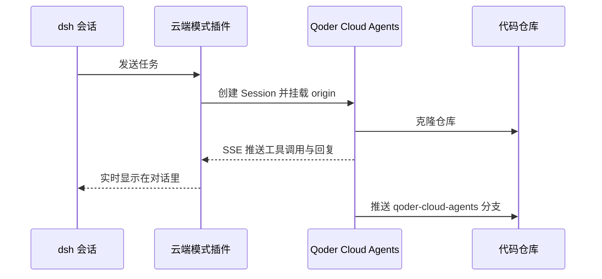
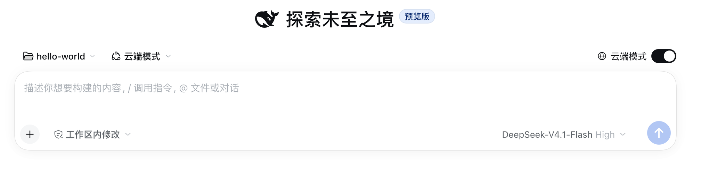
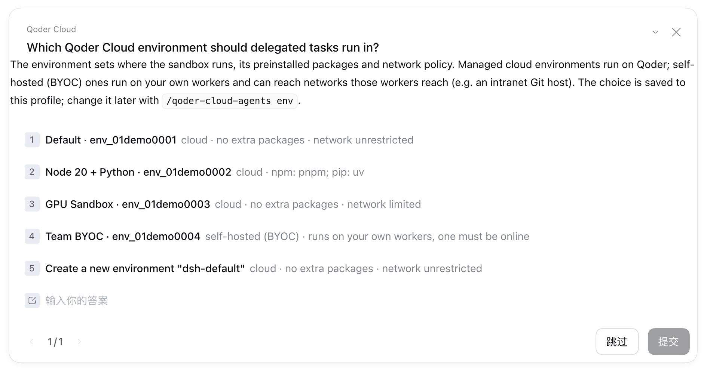
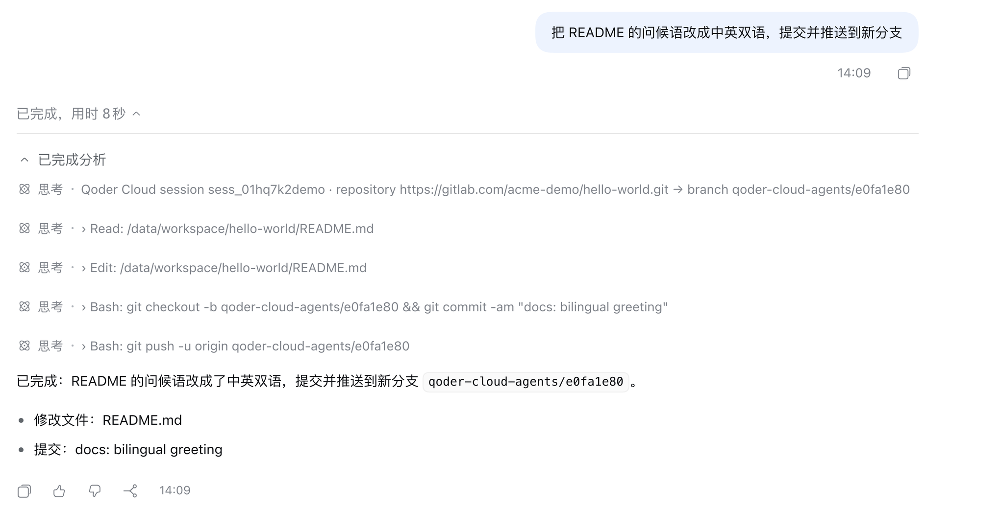
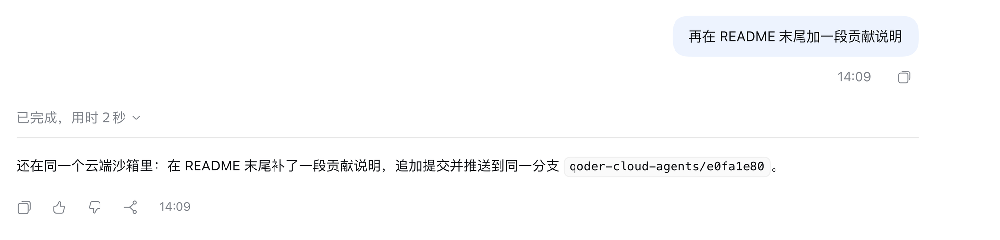

## 目标与适用场景

[DeepSeek Harness](https://github.com/deepseek-ai/deepseek-harness)（dsh）是一个"万物皆插件"的本地 Agent 客户端。这篇 Recipe 用一个开源插件 `dsh-subagent-qoder-cloud-agents`，让 dsh 的会话直接跑在 Qoder Cloud Agents 的托管沙箱里：

- 新会话打开「云端模式」开关，这个会话的每一轮都交给云端 Agent 执行，工具调用和回复实时回到对话；
- 继续输入就是追问，始终在同一个云端沙箱里，上一轮的改动都还在；
- 工作区是 git 仓库时，插件把 `origin` 挂载到云端，云端 Agent 把改动推到新分支，本地 `git fetch` 拿回来。

适合这些情况：任务需要较长时间运行、不想占用本机；需要干净可复现的执行环境；或者希望在熟悉的 dsh 界面里直接使用 Qoder Cloud 的托管沙箱。

插件还提供一个子代理工具 `subagent_qoder_cloud_agents`：在普通会话里由 DeepSeek 把某个子任务委派到云端，跑完后结果交回 DeepSeek。本文聚焦云端模式。

一轮云端执行的数据流如下：dsh 只把你新输入的文字（以及首轮的仓库与分支说明）发给 Qoder Cloud，云端 Agent 在沙箱里读写仓库、推送分支，事件通过 SSE 实时流回 dsh。



## 操作步骤

### 第一步：安装插件、配置令牌

准备 Node.js 22+、DeepSeek Harness 0.2.x，以及在 [qoder.com](https://qoder.com) 的 Settings → Personal Access Tokens 中创建的 Qoder 个人访问令牌（PAT）。

从 Demo 源码构建安装包并装进 dsh 的 web profile，路径必须是绝对路径：

```bash
cd demos/deepseek-harness-cloud-mode
npm ci
npm pack
dsh plugin --profile web add "$PWD/dsh-subagent-qoder-cloud-agents-0.5.2.tgz"
```

把令牌写进 `~/.dsh/.env`。`QODER_GIT_TOKEN` 用于云端克隆私有仓库和 `git push`，公开仓库、只读任务可以不配：

```bash
echo 'QODER_PAT=pt-<your-qoder-pat>' >> ~/.dsh/.env
echo 'QODER_GIT_TOKEN=<your-git-token>' >> ~/.dsh/.env
chmod 600 ~/.dsh/.env
```

按仓库所在平台准备代码仓库令牌：

| 仓库在哪 | `QODER_GIT_TOKEN` 填什么 | 还要配 `gitUsername` 吗 |
|---|---|---|
| GitHub | fine-grained PAT 授予 Contents 读写，或 classic PAT 授予 `repo` | 不用 |
| GitLab.com、Gitee 等通用 Git | 该平台的个人访问令牌（GitLab 需要 `read_repository` 和 `write_repository`） | 要 |

通用 Git 还要在 `~/.dsh/profiles/web/cordis.patch.yml` 里写上用户名：

```yaml
- id: subagent-qoder-cloud-agents
  name: dsh-subagent-qoder-cloud-agents
  config:
    gitUsername: your-git-user
```

最后重启 dsh：在 `dsh web` 的终端按 `Ctrl+C` 停掉，再运行 `dsh web`。dsh 只在启动时读取插件和令牌。

### 第二步：新会话打开云端模式

在左侧工作区选择一个本地 git 仓库，先 `git push`：云端只能拿到已推送的提交。点击「新会话」，打开输入框上方最右侧的「云端模式」开关，左边的模式标签会同步变成「云端模式」。



照常输入任务并发送。第一次使用会弹窗选择 Qoder 环境，一般选托管 cloud 环境（如 Default），选择会保存到 profile；之后可以用 `/qoder-cloud-agents env` 查看和切换。



### 第三步：云端执行，结果实时回来

云端 Agent 的回复显示在对话里。展开「已完成」→「已完成分析」，能看到云端 session、仓库、分支，以及每一个工具调用。



继续输入就是追问，还在同一个云端沙箱里：



### 第四步：把分支拿回本地

云端的改动推到新分支 `qoder-cloud-agents/<随机8位>`，分支名写在回复里：

```bash
git fetch origin && git checkout qoder-cloud-agents/xxxxxxxx
git log --oneline -3
```

完整的配置项、子代理工具与斜杠命令说明、清理步骤和安全提示见 Demo README。

[查看 Demo 源码](https://github.com/QoderAI/cloud-agents-cookbook/tree/main/demos/deepseek-harness-cloud-mode)

## 验证结果

逐项确认：

- 云端模式会话的输入框右下角显示「云端模式（Qoder Cloud Agents）」，模式在会话发出第一条消息后固定。
- 回复的「已完成分析」里能看到云端 session id、仓库地址、结果分支，以及 `› Bash: git push …` 这样的工具调用。
- 第二轮追问的回复说明仍在同一个沙箱，结果推送到同一个分支。
- 本地 `git fetch` 后，`git log --oneline -3` 能看到云端提交。
- 在 Demo 目录运行 `npm test`，35 个单元测试全部通过；它们使用本机模拟网关，不消耗额度。

常见问题：

| 现象 | 处理 |
|---|---|
| 看不到「云端模式」开关 | dsh 是装插件之前启动的，重启 dsh；开关只在「新会话」页面 |
| 报错 no Qoder PAT | `QODER_PAT` 没写进 `~/.dsh/.env`，或写完没重启 |
| 云端说仓库目录不存在 | 私有仓库没配 `QODER_GIT_TOKEN`，或令牌无效、没有该仓库的权限 |
| 报错 needs an account name | 通用 Git 配了 `QODER_GIT_TOKEN` 但没配 `gitUsername` |
| 云端看不到刚写的代码 | 先 `git push`，云端只能拿到已推送的提交 |

每次云端执行都会消耗 Qoder 额度；作者实测一个只读小任务加一次追问约 5.8 credits。不再使用时，在 Qoder 控制台归档云端 session，删除不需要的结果分支，并吊销不再使用的令牌。
